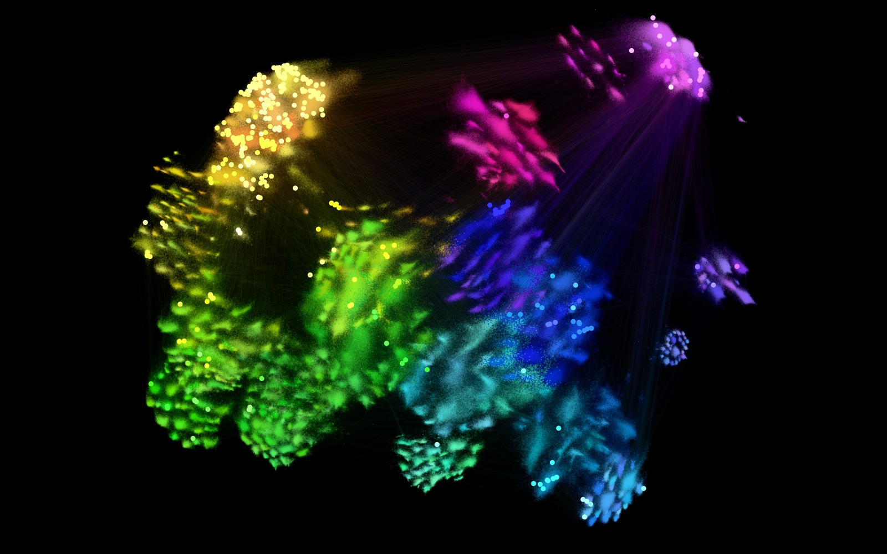
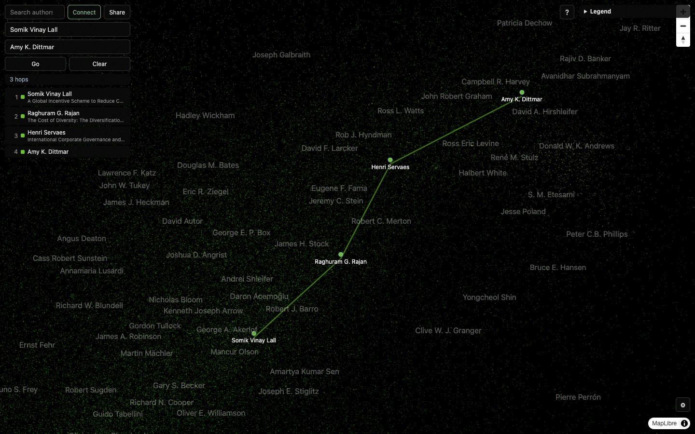

# mapademic

Created by [Eric Gao](https://github.com/EG-xry), a student at UC San Diego.

A zoomable map of 8,396,458 researchers: OpenAlex authors with 15 or more
works, positioned by coauthorship and colored by detected community. The map
is served as a static site: raster tiles plus JSON indexes, rendered in the
browser by a vanilla-JS MapLibre viewer (`web/dev.html`). No backend is
required for anything, including Connect, the shortest coauthor path between
two researchers, which the browser searches with range reads of the
release's coauthor graph. Connect began as an integration of
[academic-degree-of-separation](https://github.com/riptideiv/academic-degree-of-separation)
by [riptideiv](https://github.com/riptideiv); see
[Acknowledgements](#acknowledgements).

**Live map: [mapademic.app](https://mapademic.app)**





*Connect across economics: Somik Lall → Raghuram Rajan → Henri Servaes → Amy
Dittmar. Each researcher sits among their own coauthors, so the path walks
from the development economists (near Acemoglu, Sen and Stiglitz) to the
corporate-finance researchers (near Fama, Stulz and Harvey), one shared paper
per step.*

## Features

- Continuous zoom z0-11, with native pre-rendered tiles through z10.
- Author search across all 8.40M names, served from prefix-sharded JSON
  indexed by first and last name token.
- Hover and click for author details, enriched live from the OpenAlex API.
- Coauthor rays for a searched author, and a shortest-path overlay between
  two authors that prefers routes avoiding likely name mix-ups in OpenAlex.
- Institution-to-researcher connections using a bounded pool of researchers
  with an OpenAlex last-known affiliation, searched over the same map graph.
- Shareable URLs that encode view, active search, and active path.
- Display settings: brightness, contrast, saturation, label density, author
  label modes (normal / faint / hover-only), point rendering modes (raster,
  vector, or both), and a switch for the faint dust of loosely connected
  authors.
- Community legend with an isolate mode and per-group sub-areas, and
  two-level names (field, then country where it explains the cluster)
  overlaid on the map.

## Bring your own OpenAlex key

Open the gear menu, paste your [OpenAlex API key](https://openalex.org/settings/api),
and select **Use key**. The key is optional: the map and in-browser path search
still work without it. Your key is used for live researcher details, coauthor
lookups, restored author names, and shared-paper titles. Retry a failed lookup
after setting or replacing a key.

The key is kept in `sessionStorage` for this tab (in memory only if browser
storage is unavailable), and the input is cleared after saving. **Clear key**
removes it; closing the tab ends the session. It is sent directly to
`https://api.openalex.org` in an Authorization header, never to the map's data
host or optional path backend, and never included in share links or display
settings. Like any client-side credential, it is accessible to scripts running
on the page. A rejected key does not silently fall back to anonymous requests.

Run the frontend credential regression tests with Node.js 18+:
`node --test tests/test_openalex_byok.cjs`.

## Methodology

### Data

An OpenAlex snapshot is the source. Authors are filtered to those with 15 or
more works: 8.59 million of roughly 100 million author records are kept.
Coauthor edges are built from works with 50 or fewer authors (a single
paper with thousands of authors would otherwise contribute millions of
clique edges), weighted by repeat collaboration with fractional credit per
work. 379,431,851 edges are produced this way.

The live map is built from the 2026-09-23 release. From that release on, the
pipeline counts only scholarly works (OpenAlex "xpac" deposits, datasets
and similar bulk records had given one "author" 1.9M works and one pair an
edge weight of 447,612) and drops author records that are not people.
Rebuilt that way, the 2026-09-23 release yields 8,396,458 authors and
366,027,181 edges, the heaviest weighing 10,317.

### Layout

Positions are computed with ForceAtlas2 on cuGraph, run on an A100 GPU for
1000 iterations with Barnes-Hut approximation (theta 0.5). The run is
chunked with checkpoints so it can resume after interruption
(`slurm/run_layout.py`). Communities are detected with Leiden in the same
job: modularity 0.8034, roughly 216,000 communities, of which 37 have 1000
or more members and together hold 97.2% of authors.

### Post-processing

Raw layout coordinates are median-centered (mean is sensitive to outlier
halos) and radially compressed with an asinh transform into the unit
square. Roughly 207,000 authors in tiny disconnected components are
re-scattered as background dust rather than left at their natural position,
which is a ring at the layout's gravity/repulsion equilibrium. The centroid
of each community with 1000 or more members is expanded outward (spread
factor 1.6), opening separation between adjacent fields.

### Color

Hue is assigned from each community's centroid angle around the map center,
so spatially neighboring communities receive neighboring hues, with a small
per-community jitter in lightness and saturation. Communities below the
1000-member threshold are rendered grey.

### Rendering

Dominant community and log-density brightness are computed per pixel at
zoom 10 (a 262144 x 262144 virtual grid), then reduced by pyramid
downsampling through zoom 0 and written as PNG tiles. Coauthor edges with
weight 2 or higher and bounded length are baked into tiles at zoom 8-9.
From zoom 8 up, each author is also drawn as an anti-aliased disc sized by
citations on a log scale (`pipeline/sizing.py`): t = log(1 + c/100) /
log(1 + 150000/100), and a radius of 2^(z-10) px plus 3.5·t·2^((z-10)/2) px,
so at zoom 10 discs run from 1 px (uncited) to 4.5 px (150k+ citations). The
viewer's deep-zoom points continue the same formula, so the hand-off from
raster to points does not change sizes. The curve was chosen over plain log
and square-root scaling from side-by-side renders of real regions.

### Validation

Across all 379M edges, compared against a null of 2M random author pairs:
frequent-collaborator pairs (weight 5 or higher) have a median map distance
of 0.0145, versus 0.266 for random pairs, roughly 18x closer, and share a
detected community 92% of the time versus 7% expected by chance. In a
300,000-author sample, 94% have at least one coauthor within 2% of the map
width.

## Reproducing the pipeline

### Prerequisites

- Python 3.11 or newer.
- A virtual environment with the project installed:

  ```
  python3 -m venv .venv
  .venv/bin/pip install -e '.[dev]'
  ```

  `duckdb`, `numpy`, `pillow`, and `pyarrow` (declared in `pyproject.toml`)
  are installed as dependencies this way; the `dev` extra additionally
  provides `pytest` for the test suite.
- Roughly 40GB of free disk per OpenAlex release for pipeline artifacts,
  written under `MAPADEMIC_DATA` (default `./data`, git-ignored), plus
  scratch space for DuckDB spills during `filter` and `edges`.
- The AWS CLI, only if mirroring whole snapshot entities with `download`.
- For the layout stage only: a machine with CUDA and RAPIDS cuGraph
  (`cudf`, `cugraph`) available. This is run through the Slurm scripts in
  `slurm/` or on any A100 machine directly; `slurm/setup_gpu_env.sh`
  documents the environment setup, and `slurm/layout.sbatch` /
  `slurm/layout-expanse.sbatch` are cluster-specific submission wrappers
  around `slurm/run_layout.py`.

Environment variables read by every DuckDB-backed stage: `MAPADEMIC_THREADS`
caps the thread count, `MAPADEMIC_MEMORY_LIMIT` caps memory (e.g. `24GB`),
and `MAPADEMIC_TMP` moves DuckDB's spill files (default: a `.duckdb_tmp`
directory next to each stage's output). Point `MAPADEMIC_TMP` at the
internal disk when `MAPADEMIC_DATA` is on a slow external drive.

### Releases

OpenAlex publishes a complete snapshot quarterly (second Wednesday of
January, April, July, and October) and writes `manifest.json` last, naming
every file of the release with its byte size and row count. Keep one
`MAPADEMIC_DATA` directory per release:

```
export MAPADEMIC_DATA=data/2026-09-23
```

The first stage that touches S3 pins the release: it stamps its output
directory with a `RELEASE` file, and every later extract verifies its row
counts against that release's manifest. A directory holding another release
is refused rather than silently mixed.

### Stages

Each stage is a subcommand of `python -m pipeline`; output is checkpointed
under `MAPADEMIC_DATA`, so a stage can be re-run without redoing upstream
work. The order below is required; several stages depend on files written
by earlier ones. `slurm/run_layout.py` has its own required `--data` flag
and does not read the environment variable; pass it the same directory.

```
python -m pipeline authors                  # authors_extract/  (~4.6GB fetched of 59GB)
python -m pipeline extract                  # works_authorships/ (~45GB fetched of 707GB)
python -m pipeline filter --min-works 15    # nodes.parquet
python -m pipeline edges                    # edges.parquet
python -m pipeline prep                     # graph/*_int32.parquet (GPU-ready)
```

`authors` and `extract` read only the columns the map uses, straight from
the public S3 bucket, and write one checkpoint per source file, so an
interrupted run resumes where it stopped; `--jobs` sets how many files are
fetched at once. Each file's row count is checked against the manifest.

`filter` and `edges` count only scholarly works: OpenAlex's "xpac"
expansion records, paratext, and deposit types such as datasets and
software are excluded (see `pipeline/works.py`). `--all-works` on either
stage disables that filter, and `filter --count-from snapshot` thresholds
the snapshot's own `works_count` as builds before 2026-09 did. `filter` also
drops author records that are not people: placeholder names ("et al.",
"Anonymous", ":unav", ...) and uncited records with 1,000 or more works
(archives, newspapers, government offices); `--keep-placeholders` keeps
them.

`edges` streams each work's author list, generates coauthor pairs in
memory-sized buckets, and writes only the aggregated edges; for the
2026-09-23 release it needs about 13GB of RAM and two minutes on a laptop
(`--buckets` trades speed for memory).

`download` instead mirrors whole entities with `aws s3 sync` and verifies
the mirror against the manifest (`--deep` also decodes every row, which is
the only check that catches damaged pages on unreliable media). The
pipeline does not need it: `filter` and `regions` read the `authors`
extract when present and fall back to a `download` mirror.

The layout stage runs separately, on GPU hardware, and writes
`coords.parquet`:

```
python slurm/run_layout.py --data "$MAPADEMIC_DATA" --iters 1000
```

Its checkpoints (`layout_ckpt/`) are stamped with the graph they belong to,
and a run refuses to resume checkpoints left by a different graph.

For a new release, start from the previous map instead of random positions:

```
python -m pipeline warmstart --prev data/coords.parquet   # graph/init_pos.parquet
ITERS=300 CHUNK=50 LAYOUT_ARGS=--managed-memory bash slurm/remote_layout.sh "$MAPADEMIC_DATA"
```

`warmstart` keeps every carried-over author at its previous position and
places new ones at the weighted mean of their coauthors, so 300 iterations
settle what changed (about 30% of a cold 1000-iteration run) and fields keep
their familiar places. `remote_layout.sh` uploads the graph, submits
`slurm/layout-expanse.sbatch`, resubmits only on a wall-clock timeout, and
fetches `coords.parquet`. On Expanse's 32GB V100s the full graph needs
`--managed-memory` (spills into host RAM; about 2.6 s per iteration for the
2026-09-23 release).

With `coords.parquet` in place, the remaining stages run on CPU again;
`MAPADEMIC_DATA=<release> bash scripts/build_map.sh` runs all of them below,
plus the three browser binaries, in the required order.
`edgepx` must run after `webcoords` and before `tiles --edges`, since it
reads both `coords_web.parquet` and `edges.parquet`. `regions` names the
map from the OpenAlex institutions and topics tables (about 100 MB), so
mirror them once per release first:

```
python -m pipeline download --entities institutions topics   # snapshot/{institutions,topics}
python -m pipeline subcommunities                       # subcommunities.parquet: sub-groups of each big community (~15 min)
python -m pipeline webcoords                            # coords_web.parquet (spread 1.6; each sub-group gets its own area)
python -m pipeline edgepx                               # edges_px.parquet
python -m pipeline regions                              # regions.json: region + sub-area names (tiles names the legend from it)
python -m pipeline tiles --zooms 0-10 --edges "$MAPADEMIC_DATA/edges_px.parquet"  # tiles/ (~4.7GB)
python -m pipeline index                                # index/ (~3.5GB: label tiles, search shards, legend, community rosters)
```

The viewer's WebGL layers read flat binaries from `vector_experiment/`,
written by three scripts:

```
python -m scripts.export_points_bin       # positions.bin, attrs.bin, meta.json   (point cloud)
python -m scripts.export_ids_bin          # ids.bin                               (cloud hover)
python -m scripts.export_edges_bin        # edges_{pos,attr,fine}[_1m,_3m].bin, edges_meta.json (connection lines)
```

### Connect (coauthor paths) runs in the browser

Connect needs no server. `scripts/build_map.sh` writes the release's whole
coauthor graph in a compact, range-readable form:

```
python -m pipeline pathgraph          # <release>/pathgraph/: CSR arrays (~3.2GB, ~30s; local only)
python -m scripts.export_paths_bin    # <release>/paths/: compressed per-author lists for the browser (~1.5GB, ~9 min)
python -m pipeline index              # id shards carry each author's number in paths/
```

Authors are renumbered along a Z-order curve of their map position and each
coauthor list is stored as varint gaps (about 2 bytes per link), split into
files under Cloudflare's 512MB cacheable-object limit. The viewer's
bidirectional breadth-first search reads only the lists it expands with HTTP
Range requests (`cache: "no-store"`, since Chrome serializes requests for one
URL through its HTTP cache), visits lists in author order so a pair always
gets the same path, stops the meeting step at the first meeting, and
labels each hop with a shared paper from OpenAlex. A one-time 12MB index of
list lengths spares it every offset read; hard pairs (authors with one or two
coauthors, 7-11 steps apart) take about 1-4s. On 40 random pairs it matched
the Python search (`pathserver/search.py`) in length, with and without
flagged links. `pathserver/server.py` serves the same search over HTTP, if a
backend is ever wanted again.

OpenAlex sometimes merges namesakes into one author record, and shortest
paths are drawn to such records because they bridge fields. Links that look
like one (`pipeline/identity.py`: a common "initial + surname" whose other
end lies in a region holding under 5% of the record's coauthorship) are
flagged, about 4.5% of all links. When the shortest path uses one, Connect
searches again without flagged links and takes that route if it is at most
one step longer (in tests it always was), and otherwise marks the step.

### Publishing data (free tier)

`MAPADEMIC_DATA=<release> bash scripts/upload_r2.sh` uploads a release to the
R2 bucket under `<release>/data/`, inside R2's free tier: JSON stored
gzip-compressed (browsers decompress it), unused line tiers skipped, a hard
stop above 9.5GB (2026-09-23: 6.93GB, ~515k files), size-only comparisons so
re-runs upload only what is missing, and a week-long Cache-Control so
Cloudflare answers repeat reads. It needs an rclone remote named `r2`. Point
`DATA_BASE` in `scripts/build_site.py` at the release, rebuild `docs/`, and
delete the previous release's objects once the site has moved.

### Preview

```
bash scripts/preview.sh
```

The viewer is then available at `http://localhost:8123/web/dev.html`.
Everything works without any other service; for Connect, serve the data with
`python -m scripts.serve <dir> --port <port>` instead, since
`python -m http.server` ignores Range headers and would download whole graph
files.

### Optional path backend (older data)

Releases without `data/paths/` fall back to a backend, as the site did
before Connect moved into the browser. The deployed page sets no backend
(`API_BASE = None` in `scripts/build_site.py`) and never contacts one;
coauthor rays read OpenAlex directly.

That backend is the degree-of-separation FastAPI service (`/api/path`,
`/api/graph/expand`, `/health`) from
[academic-degree-of-separation](https://github.com/riptideiv/academic-degree-of-separation),
or `pathserver/server.py`. Set `API_BASE` in `scripts/build_site.py` (no
trailing slash) and regenerate `docs/index.html` to use one; it needs
`access-control-allow-origin` to permit the Pages origin. `web/dev.html` on
its own probes `localhost:8000`.

## Data

Everything under `data/` is a pipeline checkpoint or output and is
git-ignored; nothing large is committed to this repository.

## Connect from an institution

In **Connect**, change **From** to **Institution**, search and select the
institution, choose a destination researcher, and press **Go**. The result
starts with a real affiliated researcher and follows the existing coauthor
path overlay, including shared-paper titles and possible name-mix-up warnings.
If the destination is itself in the candidate pool, a zero-hop result shows
that researcher. Share links preserve the institution and destination IDs.

This is a bounded discovery feature, not an exhaustive institutional network:
OpenAlex supplies up to 50 most-cited researchers with 15+ works and a
matching `last_known_institutions.id`. The viewer checks every last-known
institution on each returned profile, then intersects the pool with the
published map's path index. A multi-source bidirectional BFS finds a shortest
path among those mapped candidates; as in author-to-author Connect, a route
avoiding flagged name merges may be preferred if it is at most one step longer.
The 14-hop and 8-million-link search limits still apply. Empty results do not
prove that the institution has no connection to the researcher.

[Last-known affiliations](https://help.openalex.org/data/authors/#last_known_institutions)
come from publication records and are not verified current appointments. Live
membership can also differ from the map snapshot, and the map omits low-output
researchers and edges from papers with more than 50 authors. The interface
states the candidate limit and shows which researcher supplied the affiliation.

No backend or new map export is needed. Institution API calls use the existing
JSON request helper, so the optional BYOK integration can authenticate them.
At most eight ID-shard downloads run concurrently; successful candidate lists
are cached for this session, failed requests can be retried, and editing either
endpoint or pressing Clear invalidates any running search. Older map releases
without browser paths keep author-to-author backend support but cannot run an
institution search.

Run frontend regression tests with Node.js 18+:
`node --test tests/test_institution_connect.cjs`.

## Credits

Mapademic was created and is maintained by
[Eric Gao](https://github.com/EG-xry), a student at UC San Diego.

[Bruce Wen](https://github.com/owlsowo) contributed Connect from an
institution and the optional personal OpenAlex API key (pull requests #1 and #2).

## Acknowledgements

Connect and the coauthor rays come from
[academic-degree-of-separation](https://github.com/riptideiv/academic-degree-of-separation)
by [riptideiv](https://github.com/riptideiv), a "six degrees of separation"
tool for academics (live at
[xingruic.net/tools/researchers](https://www.xingruic.net/tools/researchers)).
Its backend served both features on this map from July to October 2026: the
shortest coauthor path between two researchers with the paper behind each
step (`/api/path`), and an author's coauthors (`/api/graph/expand`). The idea,
the streamed search, and the result format the viewer still renders are that
project's. The current in-browser search (`scripts/export_paths_bin.py`,
`web/dev.html`) reimplements it over this map's own coauthor graph so the
site needs no server.

## License and attribution

Author and work data originates from [OpenAlex](https://openalex.org),
released under CC0. The viewer is built on
[MapLibre GL JS](https://maplibre.org).
